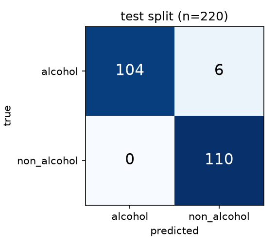

# Alcohol references in image captions

Classifies an image as `alcohol` or `non_alcohol` from the text drawn over it.
The text is read with PaddleOCR (on CPU) and decided by an explainable list of
drinks, brands, and negations. Every prediction comes with a reason.

**Result on the held-out test split (220 images): precision 1.000, recall 0.945,
F1 0.972.** 104 of 110 alcohol images were found, with 0 false alarms. The
validation split gives the same scores.

## The assignment, item by item

| requested | where |
|---|---|
| **1. Python code** | |
| Well documented, with `requirements.txt` | `predict.py`, `evaluate.py`, `explore.py`, `src/`; every module has a docstring. `requirements.txt` pins exact versions |
| Consistent results in a clean environment | pinned packages and OCR models, no randomness at inference. Checked in a fresh environment with no cache: the tests pass, and 25 test images got exactly the predictions in `results/test/results.csv` |
| Stand-alone inference script that writes `results.csv` (`file_name,prediction`) | `predict.py` (see "Run on a folder of images"). Example output: `results/test/results.csv` |
| **2. Reports and visualizations** | |
| Data exploration | [`REPORT.md`](REPORT.md) section 2, figures in `results/exploration/` |
| Methodology | [`REPORT.md`](REPORT.md) section 3 |
| Final performance metrics | [`REPORT.md`](REPORT.md) section 4; `results/test/metrics.md`, `results/test/confusion_matrix.png` |
| A few failure cases | [`REPORT.md`](REPORT.md) section 6; `results/test/errors.png` |
| Possible improvements | [`REPORT.md`](REPORT.md) section 7 |
| **3. Additional notes** | |
| Instructions and scripts to run and evaluate | this file; `evaluate.py`, `explore.py`, `download_data.py` |
| Partial successes, where the pipeline still fails | [`REPORT.md`](REPORT.md) section 5 (what worked less well and why) and section 6; the experiment scripts are in [`experiments/`](experiments/README.md) |

## Where the results are

```
results/
  test/                    held-out test split, 220 images
    results.csv            predictions in the required format
    metrics.md             precision, recall, F1 with 95% intervals, accuracy by confidence, every error
    confusion_matrix.png
    errors.png             the misclassified images with what OCR read
    predictions.csv        every image: true label, prediction, confidence, reason, OCR text
  val/                     the same for the validation split
  exploration/             data exploration figures (REPORT.md section 2)
  experiments/             written when you run a script in experiments/ (not included)
```



## Setup

Python 3.11, CPU only.

```bash
python3.11 -m venv .venv && source .venv/bin/activate
pip install -r requirements.txt
```

Without `python3.11` on the PATH, [uv](https://docs.astral.sh/uv/) fetches it:
`uv venv --python 3.11 .venv && source .venv/bin/activate && uv pip install -r requirements.txt`.

The first run downloads the PaddleOCR models (about 140 MB) to `~/.paddlex`, so it
needs internet access once.

## Run on a folder of images

```bash
python predict.py --input_dir path/to/images --output results.csv
```

`results.csv` has the columns `file_name,prediction`, one row per image, like
`data/example_results.csv`. Subfolders are included. An image that cannot be
opened gets `non_alcohol`, and a warning is printed. Add `--details details.csv`
to also get the confidence, the reason, and what OCR read for every image.
It takes about 9 seconds per image on a laptop CPU.

## Evaluate and reproduce the results

```bash
python download_data.py            # the 1,100 labelled images into data/images/
python evaluate.py --split test    # writes results/test/  (about 35 minutes on CPU)
python evaluate.py --split val     # writes results/val/
python explore.py                  # writes results/exploration/  (a few seconds)
```

`data/splits.csv` says which images are in which split. OCR output is cached in
`cache/`, so a second run takes seconds.

## Tests

```bash
python -m unittest discover -s tests -v
```

`tests/test_decision.py` checks the decision rules on text. `tests/test_predict.py`
runs `predict.py` on generated images and checks the `results.csv` format, an
unreadable file, and two clear captions. Set `SKIP_OCR_TESTS=1` to skip the OCR part.

## Code layout

```
predict.py          inference: folder of images -> results.csv
evaluate.py         metrics, confusion matrix and error images on a labelled split
explore.py          data exploration figures
download_data.py    downloads the labelled images
config.json         which image variants are read, and two thresholds
src/
  ocr.py            reads the image and its variants (mirrored, rotated, enlarged)
  normalize.py      cleans OCR text (leetspeak, accents, letter mix-ups)
  lexicon.py        drinks, brands, trap words, negations
  classify.py       text -> label, confidence, reason
  pipeline.py       which variants to read, and which line is the caption
  metrics.py        precision, recall, F1, bootstrap intervals
data/               splits.csv, example_results.csv, gold_transcripts.csv (79 hand-labelled captions)
results/            all outputs (see "Where the results are")
tests/
experiments/        the development experiments behind REPORT.md sections 3-5, one script each,
                    with their own README and requirements (not needed for predict.py)
```
