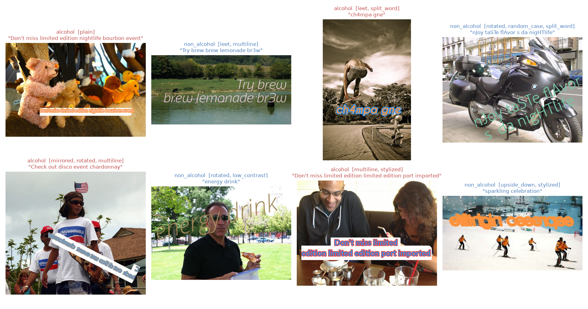
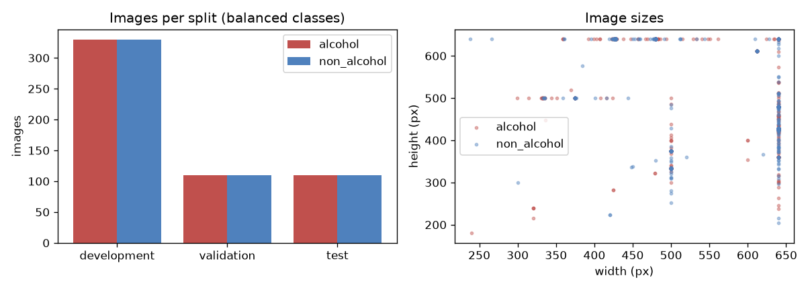
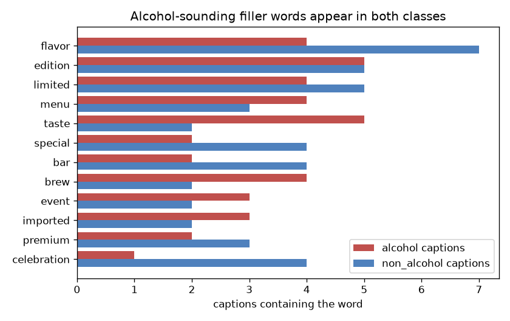
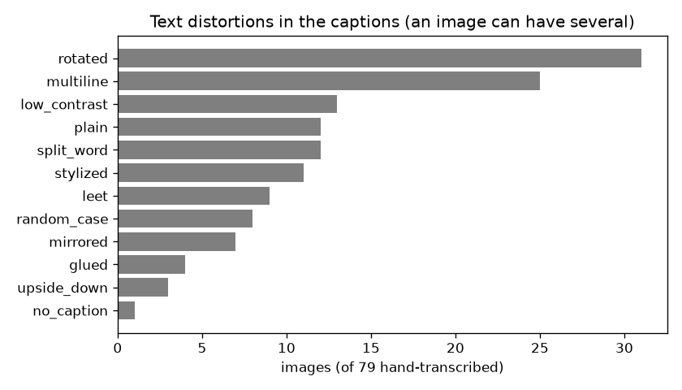
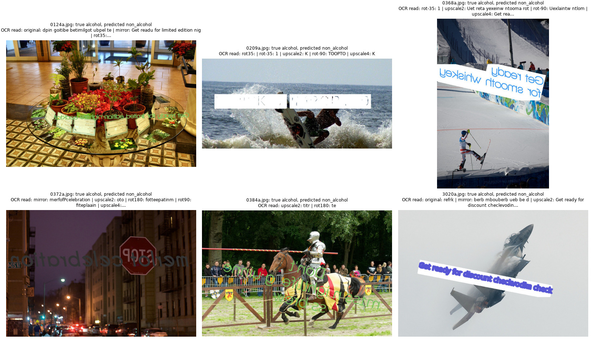

# Detecting alcohol references in image captions: report

## 1. Summary

Each image carries a caption drawn over an unrelated photo. The label depends only
on that caption, so the task is reading the text (OCR) and then deciding whether it
names an alcoholic drink.

The final model reads the image with PaddleOCR several times, on the original and
on transformed copies (mirrored, rotated, enlarged), because many captions are
mirrored or tilted. It then cleans the text and checks it against a list of drinks,
brands, and negations ("alcohol-free beer" is not alcohol). There is no trained
model, and every prediction comes with the words that decided it.

| split | images | precision | recall | F1 | false alarms | misses |
|---|---:|---:|---:|---:|---:|---:|
| test (held out) | 220 | 1.000 | 0.945 | 0.972 | 0 | 6 |
| validation | 220 | 1.000 | 0.945 | 0.972 | 0 | 6 |

The 95% bootstrap interval for test F1 is 0.947–0.991. Both splits were used during
development (section 8), so these numbers are probably slightly optimistic. The
remaining errors are captions OCR cannot read, plus a structural weakness: a brand
that is not on the list is not recognised (sections 5 and 6).

| section | content |
|---|---|
| 2 | data exploration, with figures |
| 3 | method, and why |
| 4 | final metrics |
| 5 | what worked less well, and why |
| 6 | failure cases |
| 7 | improvements with more time |
| 8 | how the test split was used, and assumptions |

## 2. Data exploration

The figures below are made by `python explore.py` and are saved in `results/exploration/`.



* 1,100 JPEG images, 550 per class, up to 640 px per side.

  

* **The label is in the caption, not the photo.** A pub photo can carry a coffee
  caption, so classifying the scene would not help, and signs in the photo are noise.
* **Captions follow an ad template:** `<opener> <filler words> <drink> <filler words>`,
  for example "Don't miss discount nightlife guinness party". The filler words are
  shared by both classes, and several sound alcoholic: *brew, bar, nightlife, party,
  premium, reserve, celebration*. Treating these **trap words** as evidence is the
  most tempting mistake in this dataset (section 5).

  

* Non-alcohol captions name other drinks (water, coffee, matcha, energy drink…) or
  other products (cannabis, CBD).
* **The text is deliberately hard to read.** I hand-transcribed 79 images
  (`data/gold_transcripts.csv`) and tagged their distortions: rotated 31, multiline
  25, low contrast 13, split word 12, stylised font 11, leetspeak (`ch4mpagne`) 9,
  mixed case 8, mirrored 7, glued words 4, upside down 3. Only 12 were plain.

  

* File names end in `a` / `na`, which leaks the label. The code never reads it.

**Split.** 60% development (660 images, used to build the rules), 20% validation
(220, used to choose between options), 20% test (220, final numbers). The split is
stratified by class, and near-duplicate images are kept in the same split.

## 3. Method

```
image ─► read with PaddleOCR on several variants ─► clean the text ─► match drinks / brands / negations ─► label + reason
```

**OCR engine.** On the hand-transcribed images I compared three engines by how often
the drink word survived OCR: PaddleOCR 0.74, EasyOCR 0.52, Tesseract 0.16. PaddleOCR
was also the most accurate per character, so it is the only engine used.

**Image variants.** OCR cannot read mirrored letters, and PaddleOCR often finds no
text at all on a steeply tilted banner. So each image is read five times: as is,
mirrored, rotated +35° and −35°, and enlarged 2× (which separates tightly packed
lines). A greedy search over ten candidates on the hand-transcribed images picked
original, mirror, +35°, upside down and −35°. On the development split, upside
down added one hit and one false alarm, so it became an extra variant. The 2× enlargement
was added after development errors showed tightly packed lines merged into one
unreadable box (+6 hits, +1 false alarm on development). All five are always read:
stopping at the first drink word would miss a negation that only another variant
reads (`beer` in the original, `alcohol-free beer` after rotating). If none of the five finds a drink, a negation, or a known
soft drink, eight more variants are read (upside down, ±90°, mirrored and rotated,
higher contrast, enlarged 4×, sharpened). About one image in five needs them.

**Finding the caption.** A caption is drawn across the photo, so its text line is
long. When a line spans at least 45% of the image and names a drink, short lines
(signs in the photo) are ignored.

**Cleaning the text** (`src/normalize.py`): lower case, accents removed, leetspeak
undone (`0→o, 1→i, 3→e, 4→a, 5→s, 7→t, @→a, $→s`), and letters OCR often confuses
folded together (`l/j→i, q→g, v→u`).

**The lists** (`src/lexicon.py`): beer, wine, spirit and cocktail words,
brands (123, including Israeli ones such as Goldstar, Maccabee, Arak, Yarden), spelling
variants (`johnny walker`, `jager`), 45 trap words that never count, and negations
(*non-alcoholic, alcohol-free, 0.0, virgin, mocktail, root beer, ginger ale*).
27 words with a common non-alcohol meaning (*port, corona, porter, patron*) count
only when spelled exactly.

**Matching** (`src/classify.py`), from most to least trusted: exact word or phrase;
a drink word glued to a template word (`importedrum` → rum); a word split by OCR
(`g in` → gin); and a spelling one or two letters off for words of six letters or
more (`jhnniewalker` → johnnie walker). The looser matches count only on the variant
OCR read most confidently, so a mirrored copy of ordinary text cannot invent a drink.

**Decision and confidence.**
* An exact drink or brand → alcohol, **high** confidence.
* A looser match or a word with a second meaning → alcohol, **medium**.
* A negation, or a clearly read soft drink and no alcohol word → non-alcohol, **medium**.
* Nothing readable → non-alcohol, **low**.

**Why no trained model.** I trained a character n-gram classifier on the OCR text
and tested it as a fallback. It raised validation F1, but it learned this dataset's
caption template rather than drinks (section 5), so it would not carry over to new
images. The rules are explainable and do not depend on the template.

## 4. Results

### Metrics

The main metric is F1 on the alcohol class. Precision and recall are reported
separately because their costs differ: for a brand-safety product a missed alcohol
ad is usually worse than a false alarm. Full tables and every error are in
`results/test/metrics.md` and `results/val/metrics.md`.

| test split | value | 95% bootstrap interval |
|---|---:|---:|
| precision | 1.000 | 1.000 – 1.000 |
| recall | 0.945 | 0.900 – 0.982 |
| F1 | 0.972 | 0.947 – 0.991 |
| accuracy | 0.973 | 0.950 – 0.991 |


### Confidence is meaningful

| confidence (test) | images | accuracy |
|---|---:|---:|
| high | 88 | 1.000 |
| medium | 100 | 1.000 |
| low | 32 | 0.812 |

All six test errors have low confidence. In production, only that group (15% of
images) would need a second look by a person or a larger model.

### Precision on a real ad stream

This dataset is half alcohol; real traffic is not. There were 0 false alarms on the
330 non-alcohol development images, so a rough 95% upper bound on the false-alarm
rate is 3/330 ≈ 0.9%. At that rate precision would be 0.99 if 50% of ads were
alcohol, 0.92 at 10%, and 0.68 at 2%. Recall and the false-alarm rate carry over to
other data; precision depends on the mix.

### What each part contributes (validation, measured during development)

The final system also has the caption-line rule and the extra variants.

| system | F1 |
|---|---:|
| original image only, exact words | 0.667 |
| + mirrored, rotated and enlarged variants | 0.791 |
| + leetspeak, negations, glued and split words | 0.928 |
| + approximate spelling | 0.948 |

## 5. What worked less well, and why

Each result below comes from a script in `experiments/` (listed in `experiments/README.md`).

| what I tried | result | decision |
|---|---|---|
| Counting trap words (*brew, bar, party*) as evidence | development recall 0.879 → 0.924, but precision 0.986 → 0.595 | dropped: these words appear in both classes |
| Character n-gram classifier as a fallback | validation F1 0.948 → 0.968; but when a brand was removed from the list, it found only 24–78% of that brand's images, with 2.7% false alarms | not used: it learned the caption template, not the drinks |
| Word n-gram classifier alone | validation F1 0.876 | dropped |
| EasyOCR and Tesseract | drink word survived 0.52 and 0.16 of the time (PaddleOCR 0.74) | dropped |
| Approximate spelling on 5-letter words too | development: 2 more hits, 3 more false alarms | dropped: short words collide (`vodka`, `stout`) |
| Upside-down and vertical flip as main variants | development: 1 more hit, 1 more false alarm | moved to the extra variants for undecided images |
| First negation rule | on 120 synthetic captions, 16 of 40 negated ones ("alcohol-free beer") were labelled alcohol | fixed: a negation now cancels the following words, and is also found when OCR splits it |
| Approximate spelling on words with two meanings | "POTTER" on a book cover became `porter` | fixed: those words count only when exact |

**The main open weakness: unknown brands.** When a brand is removed from the list,
the model finds 0–6% of that brand's images. A rule list cannot know a new brand;
this is the price of explainability, and keeping the list current is the main
maintenance cost.

**Robustness checks during development.**
* 120 captions rendered onto real photos, using 15 drinks and brands that never
  appear in the dataset, under 8 distortions (mirror, rotation, blur, heavy JPEG, low
  contrast, leetspeak, split words): every alcohol caption was found, and after the
  negation fix 119 of 120 were correct.
* 8 real photos under 13 transformations each (104 images): precision 1.000, recall
  0.865. No transformation caused a false alarm. The misses were a covered caption,
  a caption cut out of the frame, strong blur, and mirrored text rotated by 60°.

## 6. Failure cases



All six test misses are OCR failures, not wrong rules. Five of them a person can read:

| image | the caption | why OCR fails |
|---|---|---|
| `0368a` | mirrored "Get ready for smooth whiskey", tilted about 10° | mirrored and tilted at an angle between the fixed rotations |
| `0124a` | mirrored, thin green text over a cluttered table | busy background; the mirrored read stops at "limited edition nig" |
| `0372a` | mirrored grey "merlot … celebration" on a night street | low contrast; every variant reads `merfofPcelebration` |
| `3020a` | bold "checkvodka", tilted about 15° | `vodka` is read as `vodin` / `vodian` |
| `0384a` | mirrored green multiline text, steep angle, over a crowd | several difficulties at once; no variant returns text |
| `0209a` | white text on white bands, mostly erased | the letters are not in the image |

The six validation misses (`results/val/errors.png`) are the same kinds: faint grey
text over a texture, a mostly erased caption, a mirrored and tilted caption, and
yellow text on white ("budweiser" read as `badhweloer`).

## 7. Improvements with more time

1. **Separate the caption by colour.** Each caption is drawn in one solid colour.
   Keeping only that colour, as black on white, before OCR targets the low-contrast
   and busy-background misses (`0124a`, `0372a`, `0384a`).
2. **Measure the angle instead of guessing it.** The detector often finds a box it
   cannot read. Rotating by that box's angle, then reading both the original and the
   mirror, would cover the in-between angles (`0368a`, `3020a`) with fewer reads.
3. **A second OCR reader on the caption crop**, keeping a word if either reader finds
   it, for consistent misreads such as `vodian`.
4. **Grow the brand list** from Wikidata or Open Food Facts, measured with the
   remove-one-brand test in section 5.
5. **A semantic fallback for unknown brands**: a small embedding model that scores
   OCR words against "alcoholic drink", trained on word lists rather than on these
   captions so it cannot learn the template.
6. **Send the low-confidence 15% to an LLM** that must answer with its evidence words,
   evaluated on validation before use.
7. **Speed** (about 9 s per image on a laptop CPU): run the extra variants only on
   the caption crop, and batch images.

## 8. Notes

* **How the test split was used.** It was scored more than once during development
  (the earlier systems scored F1 0.963 and 0.957). One rule was prompted by a test
  error: words with two meanings count only when exact ("POTTER" → `porter`). The
  six remaining misses were inspected for section 6 only, and nothing was changed
  because of them. The validation split was used to choose between options,
  including the extra variants. Both scores are therefore probably slightly
  optimistic. The remove-one-brand test and the synthetic captions in section 5 show
  how the model behaves on text it was not built around.
* **Assumptions.** "Alcohol" means the caption names an alcoholic drink, a drink
  style, or a brand. Nightlife words alone are not enough, explicit non-alcoholic
  versions are non-alcohol, and cannabis / CBD captions are non-alcohol, as labelled
  in the data.
* The development experiments behind sections 3–5 are in `experiments/`, one
  script each (see `experiments/README.md`). Their numbers were recorded with earlier
  versions of the code; a rerun with the final code can differ slightly.
  `evaluate.py` reproduces the test and validation results in sections 1 and 4.
